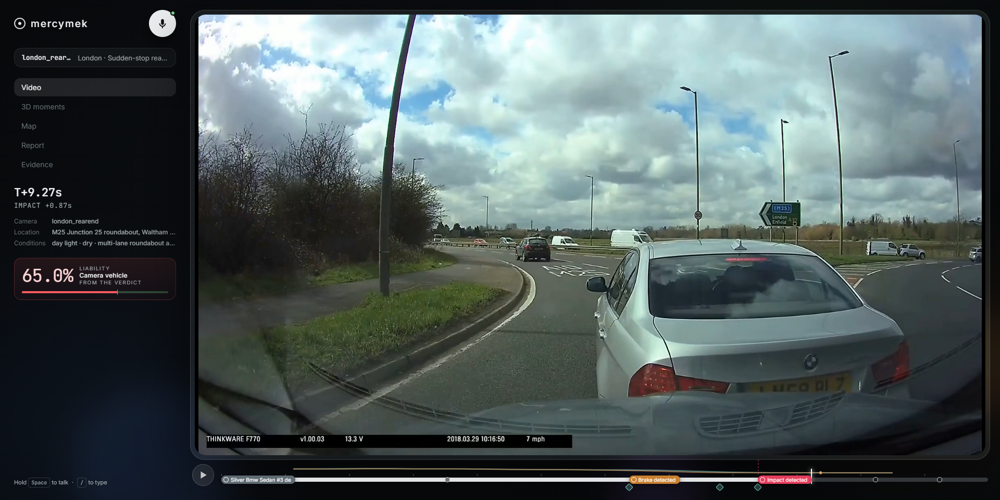
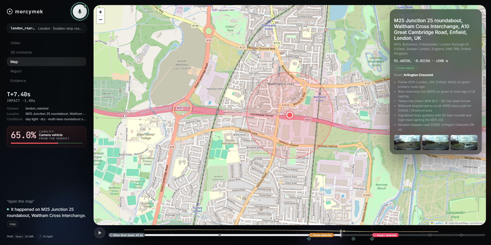

# mercymek

**A crash investigation you control by voice.** Turn a dashcam clip into a location,
vehicle and plate evidence, an estimated 3D replay, a report and an accident statement.

Built in **3 days** for the [Meta Global AI Developer Hackathon](https://cerebralvalley.ai/e/meta-ai-developer-hackathon/hackathon/submit),
**Indie** track · **Build for Your World**.



## Investigate by voice

Keep the video on screen and tell mercymek what to do: zoom in, isolate a vehicle,
read its plate, rewind, find the location, open the evidence or prepare the paperwork.
Commands control playback, analysis and navigation through the same interface.
Hold **Space** to speak; release to run the command. Press **/** to type instead.

| Say | Result |
| --- | --- |
| “Zoom in on the silver BMW” | Select and zoom the matching vehicle |
| “Zoom in on the licence plate” | Align nearby frames, enhance the crop and read the plate; unknown characters stay `?` |
| “Isolate the vehicles and rewind to three seconds before impact” | Show the selected masks and jump back in the clip |
| “Where did this happen?” | Open the inferred location, supporting visual clues and uncertainty on the map |
| “Replay the impact in super slow motion” | Play the optical-flow-interpolated impact replay |
| “Show the impact in 3D” | Open the estimated scene, with the source video available for comparison |
| “What if the camera car had been going 30 km/h?” | Recalculate avoidance ranges under the changed assumption |
| “Who is at fault?” | Open the evidence-based assessment with fault ranges and an integrity audit |
| “Objection: the SUV cut in without signalling” | Reassess the argument against the case evidence |
| “Fill in the accident statement and verify the evidence” | Prepare the statement and check the signed evidence manifest |
| “Show the evidence” | Open vehicle dossiers, plate crops, original frames and source files |

### Find the location from the video

mercymek analyses keyframes, OCR, road signs, businesses and the surrounding scene,
then combines those clues with model reasoning, web research and OpenStreetMap.
The London demo's location was inferred **without a supplied GPS track or address**.
The map shows the proposed location, its uncertainty and the evidence behind it.

This analysis runs during ingest. The spoken command opens the saved result;
the demo reuses the actual computed findings.



*London demo: the inferred location, supporting visual clues and uncertainty.*

## demo

[mercymek demo](https://youtu.be/ydpZPlMyyG8)

## Quick start

Use **Python 3.11** and a browser with **WebGL2**. Run from the source checkout;
keep `mercy/`, `frontend/` and `scripts/` together. Saved cases run without a GPU
or API key. Map tiles and online fonts still need an internet connection.

Create and activate an environment:

```bash
python -m venv .venv
# Windows PowerShell:
.venv\Scripts\Activate.ps1
# macOS/Linux instead:
# source .venv/bin/activate
```

Install the hash-locked CPU runtime and test dependencies:

```bash
python -m pip install --require-hashes -r requirements-dev.lock
python -m pip install --no-deps -e ".[dev]"
```

Prepared footage and case artifacts are distributed separately. Obtain
`mercymek-demo-data.zip` from the repository's Releases page once the first release
is published, place it in the checkout and unpack it:

```bash
python scripts/pack_demo.py --unpack mercymek-demo-data.zip
python scripts/run_demo.py --case london_rearend --no-viser --open
```

Open `http://localhost:8000`. Without API credentials, press **/** and try
`Show the evidence`, `Who is at fault`, `Where did this happen?`,
`Replay the impact in super slow motion` or `Verify the evidence`.
Cached spoken replies also work without a key.
A source-only clone has no prepared cases until a data archive is unpacked.

The main archive includes London, hero and snow. To add four more cases:

```bash
python scripts/pack_demo.py --unpack mercymek-extra-cases.zip
```

### Enable live voice and new model requests

Copy `.env.example` to `.env` and supply your own credentials:

| Setting | Needed for |
| --- | --- |
| `MODEL_API_KEY` | Live speech transcription and new Meta model requests |
| `ELEVENLABS_API_KEY` | Uncached spoken replies; voice/model settings are in `.env.example` |
| `HF_TOKEN` | Access to gated source datasets such as Nexar when downloading new data |
| `KAGGLE_API_TOKEN` | Private remote GPU jobs when rebuilding scenes |
| `MAPILLARY_TOKEN` | Optional street-level imagery viewer; sent to the browser when configured |

Meta, ElevenLabs, Hugging Face and Kaggle credentials stay on the server. Keep
`.env` and private signing keys out of Git. The app runs locally with shared case
state and no user authentication.

For uncached plate enhancement, install `python -m pip install -e ".[enhance]"`.
Its model weights download on first use. New ingest and media processing require
**FFmpeg and FFprobe** on PATH. Full reconstruction uses separate GPU/model
runtimes described in the [reconstruction guide](docs/reconstruction.md).

### Controls

Hold Space for voice; **/** opens typed commands. Use **P** for playback,
**←/→** to seek one second, **Shift + ←/→** for one frame, **1–5** to switch
screens and **Esc** to close the enhancement or replay.
Deep links can select a case, view and time:
`http://localhost:8000/?case=london_rearend&view=map&t=7.4`.

## How it works

Heavy processing runs once per case; interactive commands reuse saved artifacts
and call live models when new analysis is needed.

```text
Ingest: clip → scene understanding + masks → depth, camera and vehicle tracks
            → estimated 3D environment + replay → measurements + plate evidence
            → visual geolocation → assessment + statement → signed evidence manifest

Live:   microphone → transcription → rules / Laya / Spark → action → UI + spoken reply
```

### Meta models

| Model API surface | Role |
| --- | --- |
| **Muse Voice Transcribe** | Streamed push-to-talk transcription |
| **Muse Spark** | Scene understanding, vehicle review, location reasoning, research, plate reading, statements and command fallback |
| **Muse Wonder** | Video-based fault assessment, checked against the measured ranges |
| **Muse Image** | Reviewed empty-scene images, generated road continuation and blueprint illustrations |
| **SAM 3.1** | Vehicle, plate, face and sky masks; live object queries |

The reconstruction also uses **VGGT-1B** for depth and camera poses, **SHARP** for
Gaussian environments and **WildDet3D** where qualified RGB vehicle estimates are
available. Around them: Laya for intent routing, RAFT for slow motion,
Real-ESRGAN for enhancement, Spark.js/three.js for rendering and ElevenLabs for speech.
Methods, per-stage provenance and fallback behaviour are documented in
[docs/reconstruction.md](docs/reconstruction.md).

## Prepared cases

| Case | Source | Focus |
| --- | --- | --- |
| `london_rearend` | Dash Cam Owners World · CC BY 3.0 | Main film: visual location inference, plate evidence and roundabout rear-end |
| `hero` | Nexar 00348 | Daytime suburban collision |
| `snow_pileup` | Wikimedia Commons · public domain | Toronto pileup with a visible GPS/speed overlay for comparison |
| `cutin_rearend` | Wikimedia Commons · public domain | Cut-in/rear-end and plate evidence |
| `lanechange` | Nexar 00029 | Highway cut-in near-miss |
| `night_rain` | Nexar 00058 | Low visibility and wider wet-road uncertainty |
| `vegas_rearend` | Fyrokid · CC BY 3.0 | Witness-camera collision; the readable bystander plate is kept separate from the incident vehicles |

Nexar source plates are blurred. Plate readings are associated with the correct
vehicle; unknown characters remain unknown. Each case retains source provenance,
license and attribution in its metadata and Files panel. Full film credits are in
[docs/demo-credits.md](docs/demo-credits.md); data terms are in
[THIRD_PARTY_NOTICES.md](THIRD_PARTY_NOTICES.md).

## Estimates and evidence

- 3D scenes, hidden surfaces and road continuations are estimated/generated and
  labelled in the viewer. Vehicle meshes approximate shape; damage and deformation
  are not recovered. Monocular scale depends on camera-height and vehicle-size priors.
- Counterfactuals vary assumptions such as speed, reaction time and friction;
  they produce ranges. Fault assessments are not legal determinations.
- Interpolated slow-motion frames, enhanced images and blueprint illustrations
  are viewing aids. Original-frame evidence remains available separately.
- The signed SHA-256 manifest detects changes after sealing. It does not establish
  that the original footage was authentic.

## Development and checks

After the quick-start installation, with FFmpeg and FFprobe on PATH:

```bash
python -m pytest -q -ra
python scripts/check_public_repo.py --history
```

Tests run without API credentials. Saved-case contract tests, optional exported
GLBs and the SAM smoke-artifact test skip when their fixtures are absent.
Generate the optional vehicle assets with `node scripts/export_vehicle_library.mjs`.
The [CI workflow](.github/workflows/ci.yml) uses the same hash-locked CPU dependencies.
Local validation results and the hosted-CI status are recorded in the
[public release review](docs/public-release-review.md).

For new ingest, reviewed sources require a provenance manifest and must satisfy
the [source-quality requirements](docs/reconstruction.md#new-video-requirements).
The detailed guide also covers the private Kaggle setup, scene rebuilding and
optional local reconstruction environments.

## Licensing and documentation

No license is granted for project-authored code. Third-party libraries, models
and media retain their own terms; see [THIRD_PARTY_NOTICES.md](THIRD_PARTY_NOTICES.md).
Keep the Nexar notice and case-specific attribution with redistributed data.

- [Hackathon submission](SUBMISSION.md)
- [Reconstruction implementation and advanced setup](docs/reconstruction.md)
- [Changelog](CHANGELOG.md) and [release procedure](docs/releasing.md)
- [Public release review](docs/public-release-review.md)
