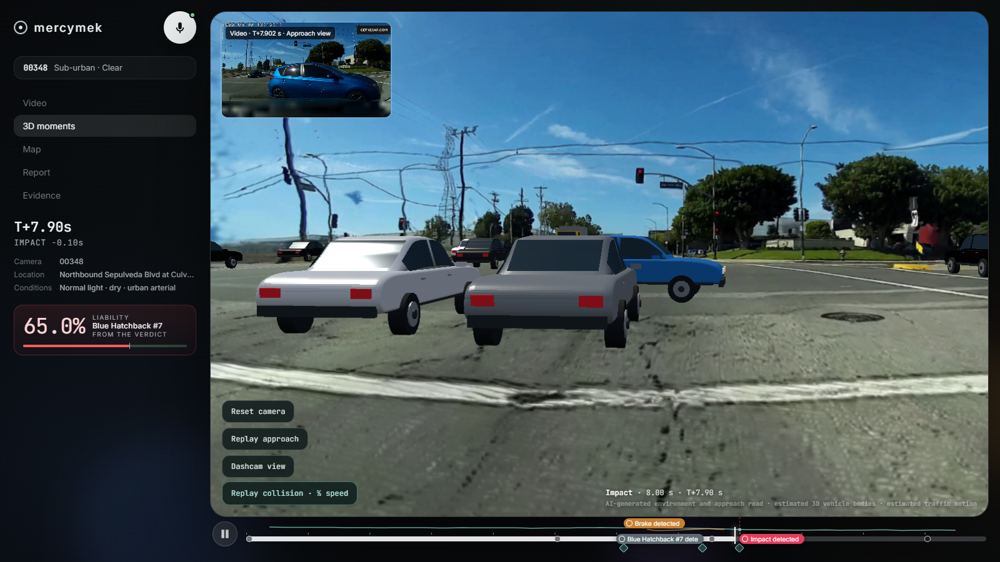

# mercymek — submission pack

Built in **3 days** for the [Meta Global AI Developer Hackathon](https://cerebralvalley.ai/e/meta-ai-developer-hackathon/hackathon/submit) · Indie track · theme **Build for Your World**.

## One line

Talk to a dashcam clip and it becomes a crash investigation: the key instants rebuilt in 3D, the fault shares as honest
ranges, the plates read, the accident statement filled in, the evidence sealed.



## The problem

After a crash it is one driver's word against another's. A dashcam clip is the best evidence there is, but a clip is
not an answer: nobody can read speeds off it, see the scene from the other car, or turn it into the paperwork an
insurer or a court asks for. A reconstruction expert does that by hand, for days, for a fee that only makes sense for
the big cases. Everyone else argues from memory.

## What mercymek does

You hold Space and talk. The video stays the main screen; every other screen is one sentence away.

| You say | You get |
| --- | --- |
| "Show the impact in 3D" | the instant of impact rebuilt as a Gaussian-splat world with full vehicle models on their tracked paths; fly through it |
| "Replay the approach" | the lead-up replayed at half speed through the reconstructed street, cars on their tracked paths |
| "Replay the impact in super slow motion" | ×4 slow motion with in-between frames reconstructed from optical flow |
| "What if the camera car had been going 30 km/h?" | avoidance analysis as ranges: "At 30 km/h instead of 73, the camera car stops 23 to 25 metres before the impact point. The crash is avoided." |
| "Who is at fault?" | Muse Wonder watches the clip and reads the measurements: fault shares as ranges with an integrity audit |
| "Objection: the SUV cut in without signalling" | Mercy mode: the judge weighs your argument against the evidence; the liability meter moves only if it holds |
| "Zoom in on the licence plate" | multi-frame fusion + ×4 super-resolution; unreadable characters stay `?` instead of being guessed |
| "Where did this happen?" | geo-sleuth OCR + Muse Spark judgement + OpenStreetMap, with the uncertainty drawn |
| "Fill in the accident statement" | the European Accident Statement (circumstances, points of impact) from the evidence |
| "Verify the evidence" | re-hashes 248 files and checks the signature of the evidence seal |

## Why it is worth building

* **Who it is for**: drivers and fleets with a dashcam, insurers triaging claims, lawyers, anyone who has to prove what
  happened without hiring an expert. The output is the paperwork they already need: statement, fault range, evidence
  list, location.
* **Honest by construction**: every number is a range with its method, hidden geometry is labelled generated, the
  blueprint is marked as illustration, the plate reader marks unknown characters. The audit rejects a verdict whose
  numbers fall outside the measured ranges. A tool that overclaims is useless as evidence; this one is built to survive a
  sceptical reader.
* **Cached by design**: heavy reconstruction runs once per clip. Saved scenes and findings are reused locally;
  live transcription and new model requests still use their respective API services.

## Meta technology, all five Model API surfaces

| Model | Used for |
| --- | --- |
| **Muse Voice Transcribe** | push-to-talk speech → text, streamed from the browser through the server (key never leaves it) |
| **Muse Spark** | finding the event time, scene and road reading, vehicle identity/heading review, location judgement, web research, accident statement, plate reading, deep command parsing when rules and Laya are unsure |
| **Muse Wonder** | the verdict: it watches the clip together with the measurements, and its output goes through the integrity audit |
| **Muse Image** | clean empty-scene plates (vehicles removed), the generated road continuation, the blueprint illustration |
| **SAM 3.1** | masks for vehicles, plates, faces and sky; faces are blurred with them; live "find the …" queries |
| Meta open weights | **VGGT-1B** (depth + camera poses from the clip) |

Around them: Laya (command intent), RAFT (slow motion), Real-ESRGAN (plates), AnySplat (splat worlds), Spark.js + three.js
(rendering), ElevenLabs v4 Turbo (spoken answers).

## Run it (judges)

The repo carries code only. The prepared source ZIP and two sealed-data archives
are listed in the [delivery guide](docs/delivery.md). The main data archive contains
the London case shown in the film plus hero and snow examples; the optional extra archive adds four cases.

Follow the [README quick start](README.md#quick-start) to create and activate a
Python 3.11 environment and install the hash-locked CPU dependencies. Then run:

```bash
python scripts/pack_demo.py --unpack mercymek-demo-data.zip
python scripts/pack_demo.py --unpack mercymek-extra-cases.zip    # optional: four more cases
python scripts/run_demo.py --case london_rearend --no-viser --open
```

For live voice and new model requests, copy `.env.example` to `.env` and supply
your own `MODEL_API_KEY`; add `ELEVENLABS_API_KEY` for uncached spoken replies.

Without any key everything cached works: video, 3D moments, report, map, evidence, slow motion, what-if, statement,
seal. Type a command with `/` (the typed command line) if there is no microphone.
Use `python -m pip install -e ".[dev]"` followed by `python -m pytest -q -ra`.
Saved-case and local smoke-fixture tests skip when their data is absent.

## Honest limits

Monocular video: scale comes from an assumed 1.2–1.5 m camera height, hidden bodywork and deformation are estimated, and
the scene outside the camera's view is generated and labelled so. mercymek is not a legal determination.

---

## 3-minute demo video (the primary judging artifact)

The edited film is `deliverables/mercymek-3-minute-demo.mp4`: 180 seconds at 1080p,
with English ElevenLabs narration, burned-in captions, a separate SRT and chapter
markers. The production script is [docs/demo-storyboard.json](docs/demo-storyboard.json).
Revision 6 follows one London case: ten real spoken commands, plate reading,
automatic location inference from visual surroundings without GPS, counterfactuals,
report, statement and evidence verification. A brief same-frame original/3D
comparison appears at 1:57–1:59, followed by the actual web-app 3D view at
1:59–2:02. At 2:02–2:11, a spoken command opens
the Evidence page with dossiers, the verified plate and source files. The following table is the original live-presentation guide; use
`docs/demo-storyboard.json` for the finished film.

Record at 1080p, browser full screen, microphone on, ElevenLabs voice audible. Pre-warm: open `?case=hero&view=scene&t=8`
once so the splats are cached (first load takes ~15 s), then reload to `?case=hero`.

| Time | On screen | You say / do |
| --- | --- | --- |
| 0:00–0:15 | Hero clip playing, the crash happens | Voice-over: "Every day two drivers argue about what a dashcam clip shows. mercymek turns the clip into an investigation you can talk to." |
| 0:15–0:40 | Hold Space | **"Isolate the vehicles and rewind to three seconds before impact."** (masks light up both cars, the video jumps) |
| 0:40–1:15 | 3D moments | **"Show the impact in 3D."**, then **"Replay the approach."** — the lead-up flies through the reconstructed street with the cars on their tracked paths. Keep camera moves small (a gentle drag); wide orbits reveal what a single forward-facing clip never saw. Voice-over: "The world is generated from the footage; the cars are complete models on their tracked paths." |
| 1:15–1:30 | Video | **"Replay the impact in super slow motion."** |
| 1:30–1:50 | Video, what-if | **"What if the camera car had been going 30 km/h?"** — the answer is spoken, the clip replays from the hazard. |
| 1:50–2:20 | Report | **"Who is at fault?"** — fault shares as ranges, integrity audit. Then (live): **"Objection: the blue car cut in without signalling."** and let the judge answer. |
| 2:20–2:35 | Map | **"Where did this happen?"** |
| 2:35–2:50 | Report | **"Fill in the accident statement."**, then **"Verify the evidence."** — "All 248 files match the seal." |
| 2:50–3:00 | Title card | "Five Meta models, one question: what really happened? mercymek." |

Optional swap for 0:40–1:15 if the 3D load is slow: switch to `cutin_rearend` and say **"Zoom in on the licence plate."**

## Submission checklist

* [x] [Public GitHub repo](https://github.com/helizac/mercymek), no `.env`, no `data/` (checked by `git ls-files`)
* [x] Source and sealed demo-data ZIPs prepared locally
* [x] 3-minute video recorded and edited, with English ElevenLabs narration and captions
* [ ] Data ZIPs uploaded as release assets; hosted links added to the README
* [ ] Finished video uploaded; hosted link added to the portal
* [ ] Track: **Indie**; theme: **Build for Your World**
* [ ] Portal text: paste "One line", "The problem", "What mercymek does" and the Meta table above
* [x] Clean extracted install verified without API keys: seven cases, original seals, cached speech, commands and cached plate enhancement
